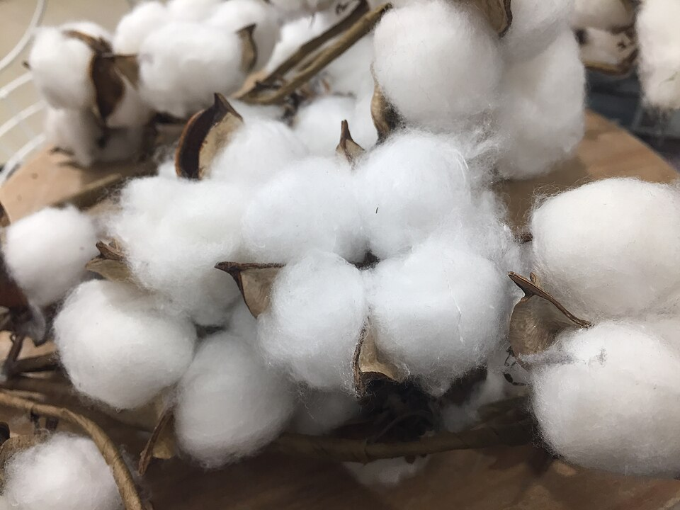
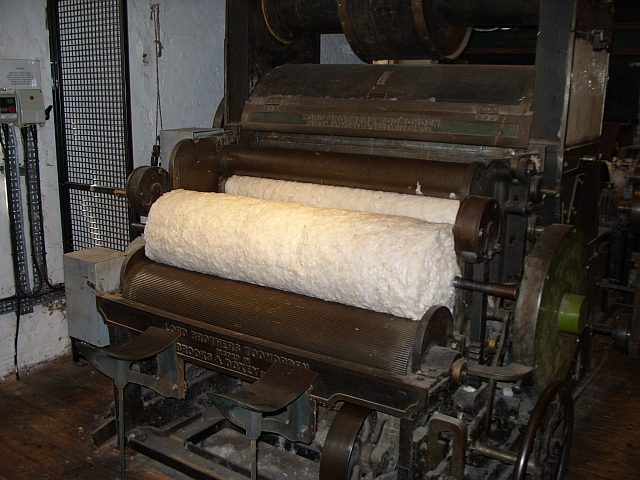
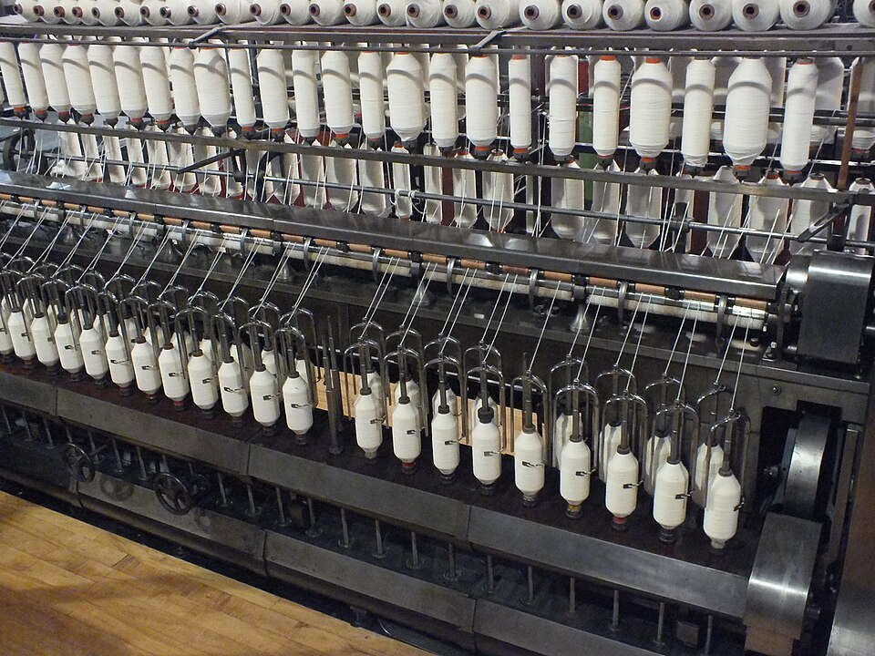
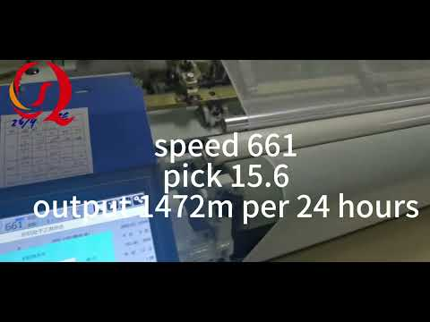
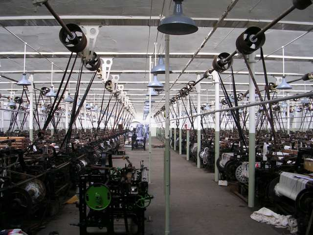
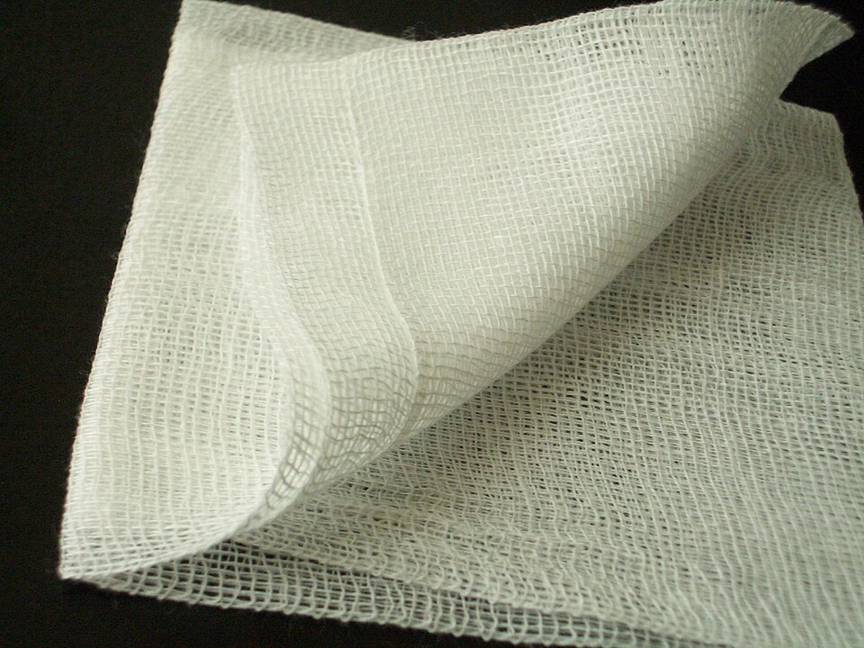
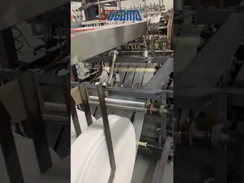
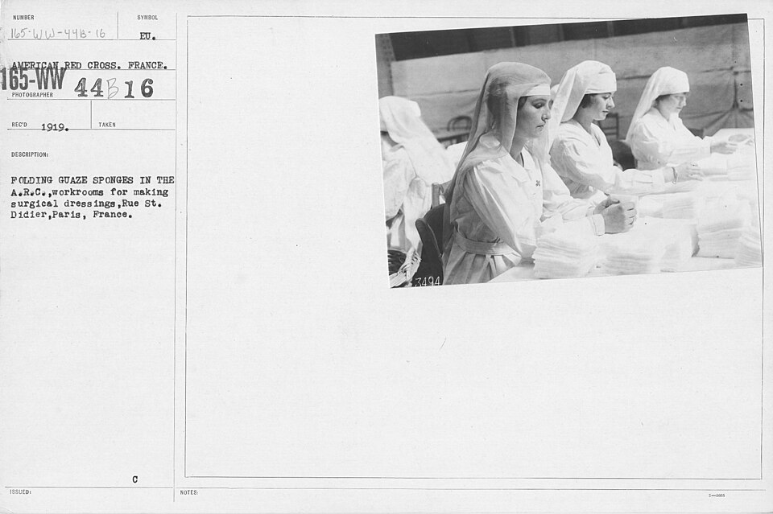
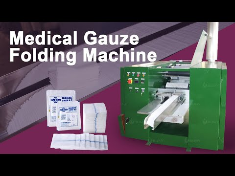

# Quy trình băng gạc y tế: từ bông đến miếng gạc (MAT, 2026-11-05)

*Tài liệu nghiên cứu cho anh Nhật. Mỗi số liệu có nguồn; chỗ nào chưa kiểm chứng ghi rõ CHƯA XÁC MINH. Giá chỉ tính VND.*

MAT: **Tổng quan chuỗi:** Bông xơ → Kéo sợi → Dệt vải gạc (vải mộc) → Nấu, tẩy trắng, giặt, sấy → Cuộn vải gạc lớn → Cắt, gấp miếng gạc → Đóng gói → Tiệt trùng (nếu là gạc vô trùng).

Theo một nhà sản xuất gạc Trung Quốc (Rito Medical), cả chu trình từ bông tới miếng gạc vô trùng mất gần 100 ngày.

MAT: ## 1. Bông là bông gì?

- Là **sợi bông của cây bông vải** (cotton). Mỗi hạt bông mang 5.000–10.000 sợi. Sợi dài 1–5 cm: dưới 25 mm là ngắn, 25–30 mm là trung bình, 30–50 mm là dài. Thành phần khoảng 98% cellulose (giáo trình Dược liệu, ĐH Y Hà Nội).
- Trong y tế chia 2 loại: **bông xơ** (chỉ cán bỏ hạt, nhặt tạp, không hút nước) và **bông hút nước** (đã tẩy hết chất béo rồi tẩy trắng). Sợi bông rỗng ruột như ống mao quản nên hút nước, **nhưng chỉ khi đã tẩy sạch lớp sáp, chất béo**. Đó là lý do phải nấu tẩy.
- Việt Nam gần như **nhập toàn bộ bông**: năm 2025 nhập 1,71 triệu tấn bông, trị giá 2,88 tỷ USD, bông Mỹ chiếm nhiều nhất; bông trong nước đáp ứng dưới 1% nhu cầu (Báo Đầu Tư; con số dưới 1% em mới thấy qua phần trích, chưa mở bài gốc).

MAT: ## 2. Kéo sợi làm thế nào?

Mục tiêu: biến đám xơ bông rối thành một sợi chỉ dài, đều và chắc. Dây chuyền chải thô (loại dùng cho sợi trung bình như sợi gạc) gồm: **Cung bông → Chải → Ghép I → Ghép II → Kéo sợi thô → Kéo sợi con → Đánh ống**.

- **Cung bông (blowroom):** xé kiện bông nén chặt cho tơi ra, đập bỏ đất cát, vỏ hạt, trộn nhiều kiện cho đều chất lượng.
- **Chải (carding):** trục có kim nhỏ chải xơ cho thẳng, song song, loại tạp và xơ quá ngắn, ra một **"cúi"**: dải bông mềm to cỡ ngón tay.

- **Ghép (drawing):** gộp 6–8 cúi lại rồi kéo dãn ra, để chỗ dày bù chỗ mỏng, cúi đều hơn. Làm 2 lần.
- **Kéo sợi thô (roving):** kéo cúi mảnh lại và xoắn nhẹ, quấn lên ống, gọi là "sợi thô".
- **Kéo sợi con (ring spinning):** kéo mảnh tiếp tới đúng độ mảnh cần, xoắn mạnh để sợi chắc, quấn lên ống nhỏ. Đây là sợi thành phẩm.

- **Đánh ống:** quấn sợi sang ống lớn, cắt bỏ đoạn lỗi.
- **Chi số sợi (Ne):** số càng lớn thì sợi càng mảnh. Sợi gạc y tế Việt Nam thường là **Ne 32/1** (32s/1), theo thông số của Bông Bạch Tuyết và Minh Hưng.

MAT: ## 3. Dệt vải gạc

- Gạc là **vải dệt trơn, thưa** (sợi dọc và sợi ngang đan lên-xuống từng sợi một, để hở lỗ lưới) nên thoáng và hút dịch nhanh. Dệt trên máy dệt công nghiệp, hiện nay chủ yếu là máy dệt khí (air-jet).
- Vải vừa dệt xong, chưa tẩy, gọi là **vải mộc**: màu ngà xám, chưa hút nước tốt.
- **Mật độ sợi** quyết định độ dày và độ hút. Bông Bạch Tuyết công bố: **dọc 7 sợi/cm, ngang 6 sợi/cm**, sợi 32s/1, nặng **22 ± 2 g/m²**. Minh Hưng ghi 18–20 sợi/inch, 25–30 g/m². Thị trường quốc tế gọi theo sợi/inch như 17×13, 19×15, 20×12 (Sunmed).
- Em chưa mở được văn bản gốc Dược điển Việt Nam về mật độ sợi; các số trên lấy từ trang nhà sản xuất có ghi "đạt Dược điển Việt Nam".

MAT: ## 4. Nấu, tẩy trắng, giặt, sấy

- **Nấu (tẩy dầu mỡ):** nấu vải mộc trong dung dịch kiềm nóng để gỡ sáp, chất béo, pectin. Bước này làm vải biết hút nước.
- **Tẩy trắng:** dùng **oxy già (H2O2)**. Các nhà sản xuất Việt Nam đều ghi "tẩy trắng bằng oxy già", không dùng chất làm trắng quang học, không hồ tinh bột.
- **Giặt sạch** hết hóa chất, rồi **sấy căng** cho vải phẳng, khổ đều (Sunmed). Tẩy quá tay thì sợi yếu, dễ bụi xơ, rách ở nếp gấp.
- **Kiểm nghiệm theo Dược điển Việt Nam V** (số liệu Bông Bạch Tuyết công bố): chìm trong nước **≤ 8 giây**; **1 g gạc giữ ≥ 5 g nước**; trung tính (không acid, không kiềm); chất tan trong nước, chất tan trong ether ≤ 0,5%; độ trắng ≥ 80%.

MAT: ## 5. Vải gạc cuộn trông thế nào?

- Là cuộn vải gạc trắng, rất mỏng nhẹ, lỗ lưới nhìn xuyên được. Khổ phổ biến ở Việt Nam **0,8 m** (Bông Bạch Tuyết bán gói 200 m, kiện 1.000 m). Loại quốc tế thường là cuộn lớn khổ 90 cm × 100 yard (khoảng 91 m) (Sunmed).
- Nhẹ: 1 m² chỉ khoảng 22 g, nên 1 cuộn 0,8 m × 200 m (160 m²) nặng khoảng 3,5 kg (em tự tính từ 22 g/m²).

MAT: ## 6. Cắt, gấp miếng gạc thủ công

- **Kích thước phổ biến** (Bảo Thạch): 5×5, 7,5×7,5, 10×10 cm…, số lớp **6, 8 hoặc 12 lớp**. Quốc tế có cả 16 lớp.
- **Nguyên tắc gấp:** mép cắt phải **gập vào trong**, để không có sợi xơ rời bung ra dính vào vết thương (Rito Medical: gấp "để che đi các cạnh thô").
- **Cách làm thủ công**, em mô tả nguyên tắc, chưa có tài liệu Việt Nam chính thức:
- Trải vải gạc lên bàn inox sạch, dùng khuôn hoặc thước cắt thành tấm chữ nhật đúng cỡ.
- Gấp 2 mép dài vào giữa (giấu mép cắt), rồi gấp đôi theo chiều dọc.
- Gấp 2 đầu ngắn vào trong, rồi gấp đôi lần nữa, ra một miếng vuông nhiều lớp. Số lần gấp quyết định 8, 12 hay 16 lớp.
- Thường dùng một **khuôn gấp (jig)**, tức là tấm cứng đúng kích thước, để mọi miếng bằng nhau.
- **Vệ sinh:** người làm đội mũ, đeo khẩu trang, găng tay, mặc áo choàng, như trong ảnh xưởng gấp gạc của Hội Chữ thập đỏ Mỹ dưới đây. Với gạc y tế bán ra, khâu đóng gói phải làm trong khu sạch có kiểm soát; gạc vô trùng còn phải tiệt trùng bằng khí EO hoặc tia gamma (Sunmed).

MAT: ## 7. Máy gấp gạc làm gì?

- Máy kéo vải gạc từ cuộn lớn, **xẻ dọc theo khổ, gấp mép vào trong, cắt ngang và gấp thành miếng** 8, 12 hoặc 16 lớp, rồi xếp chồng ra băng tải. Một máy thay được nhiều người gấp tay. Có máy làm được nhiều kiểu gấp (gấp kiểu Mỹ, gấp kiểu Pháp, gấp bệnh viện, theo mô tả máy KERRIAN trên MadeInChina).
- Ở Việt Nam có Amimexco quảng cáo bán "máy cắt, gấp gạc y tế" (video bên dưới). **Giá máy bằng VND: CHƯA XÁC MINH**, cần xin báo giá trực tiếp.

MAT: ## 8. Giá tham khảo thành phẩm (VND, giá bán lẻ trên web)

| Sản phẩm | Giá | Nguồn |
|---|---|---|
| Gạc miếng 5×5 cm, cây 100 miếng (Bảo Thạch) | 45.000–55.000 đ/cây | trungtamphumyhung.vn |
| Gạc cuộn 10 cm × 5 m | 4.000–6.000 đ/cuộn | thietbiyteminhphuong.com |
| Băng cuộn Bảo Thạch 0,1 × 2 m, gói 5 cuộn | 17.000 đ/gói | nhathuoclongchau.com.vn |
| Băng cuộn 0,09 × 2 m tiệt trùng, gói 5 cuộn | 22.500 đ/gói | shop.bongbachtuyet.com.vn |

**Giá vải gạc mộc hoặc vải gạc cuộn khổ 0,8 m bán sỉ, và giá máy gấp: CHƯA XÁC MINH**. Bông Bạch Tuyết ghi loại 0,8 m là "hàng tặng không bán". Cần gọi báo giá nhà dệt gạc (có nhiều xưởng ở Hà Nam).

MAT: ## 9. Video thật để xem

- Kéo sợi (tiếng Việt): [Quy trình sản xuất sợi COTTON](https://www.youtube.com/watch?v=bzZAWreQAgo)
- Kéo sợi, nhà máy hiện đại (Rieter, tiếng Anh): [The World of Spinning](https://www.youtube.com/watch?v=gDUVkqUVHvM)
- Dệt và làm vải gạc: [medical gauze manufacturing process](https://www.youtube.com/watch?v=q8ef0TIPSkw)
- Dây chuyền cắt và gấp gạc từ cuộn lớn: [medical gauze swab cutting and folding production line](https://www.youtube.com/watch?v=bl0OkGqzYuU)
- Máy gấp gạc 16 lớp: [Gauze Folding Machine – 16 ply fold](https://www.youtube.com/watch?v=9pksc1kMe7U)
- Máy gấp gạc (tiếng Việt): [Máy gấp gạc y tế](https://www.youtube.com/watch?v=3pq3BWLijIw)
- Máy cắt, gấp gạc bán tại Việt Nam: [Bán máy cắt, gấp gạc y tế – Amimexco](https://www.youtube.com/watch?v=4Rof6itk9vk)

*Ghi chú: em chưa tìm được video quay cảnh gấp gạc thủ công trong xưởng Việt Nam có nguồn đáng tin.*

MAT: ## 10. Nhận xét cho mình

- Kéo sợi, dệt, tẩy trắng là việc của **nhà máy**, mình không làm nhỏ được. Hướng thực tế là **mua vải gạc đã tẩy (đạt Dược điển Việt Nam) rồi cắt, gấp, đóng gói**.
- Gấp tay làm được, nhưng bán làm hàng y tế thì vẫn cần khu sạch, kiểm nghiệm, công bố trang thiết bị y tế loại A, và tiệt trùng nếu bán gạc vô trùng (xem báo cáo trước).
- Bước tiếp theo: xin báo giá vải gạc cuộn 0,8 m và máy gấp tại Việt Nam.

MAT: ## Nguồn

- Giáo trình Dược liệu, ĐH Y Hà Nội: yhn.edu.vn/portals/0/tailieu/BMduoc/duoclieu/files/basic-html/page32.html
- Bông Bạch Tuyết, gạc khổ 0,8 m: shop.bongbachtuyet.com.vn/products/gac-y-te-kho-0-8m-1
- Minh Hưng, gạc hút nước: thietbiyteminhhung.vn/products/gac-hut-nuoc-0-8x10m
- Bảo Thạch, gạc y tế: baothach.com.vn/gac-y-te-2/
- Báo Đầu Tư, nhập khẩu bông 2025: baodautu.vn/nhap-bong-xo-soi-det-nam-2025-tren-57-ty-usd-bong-tu-my-ap-dao-d513000.html
- Dây chuyền kéo sợi chải thô: slideshare.net/slideshow/comprehensive-technology-and-process-of-cotton-yarn-production/287910134
- Sunmed, bên trong nhà máy gạc: vi.szsunmed.com/news/industry-news/inside-a-gauze-factory-how-medical-gauze-rolls-swabs-and.html
- Rito Medical, hành trình sản xuất gạc: vi.rito-medical.com/news/the-full-production-journey-of-medical-gauze-swabs.html
- Ảnh: Wikimedia Commons (Cotton in bush; Restored carding machine at Quarry Bank Mill; Ring spinning frame MOSI; Queen Street Mill Weaving Shed; Gauze 03; American Red Cross, Folding gauze sponges, NARA 20803954). Ảnh máy lấy từ ảnh đại diện của chính các video YouTube nêu trên.
