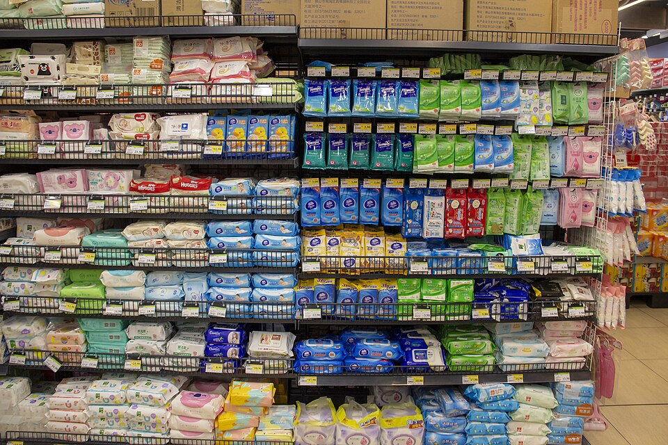
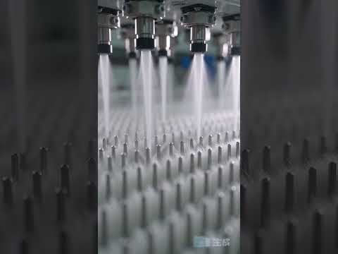
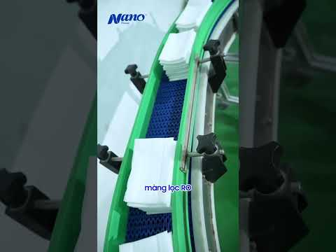
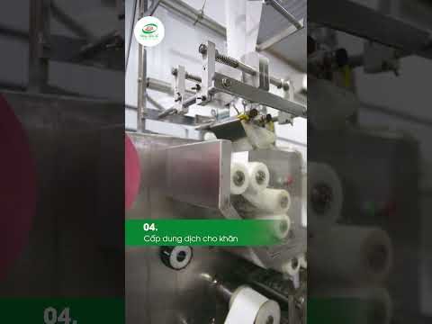
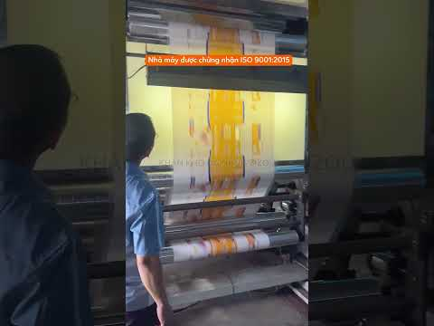
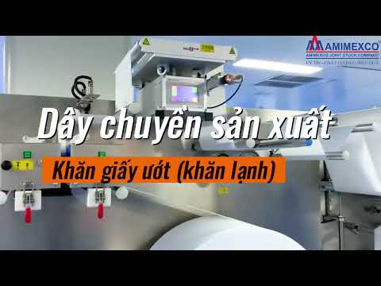

# Khăn khô đa năng & khăn ướt: nguyên liệu, quy trình, pháp lý, chi phí (MAT, 2026-11-05)

*Tài liệu nghiên cứu cho anh Nhật. Mỗi số liệu có nguồn. Chỗ nào chưa kiểm chứng ghi rõ CHƯA XÁC MINH, chỗ em tự tính ghi rõ ƯỚC TÍNH. Giá tính bằng VND.*

MAT: **Tổng quan:** Khăn khô đa năng và khăn ướt đơn giản hơn gạc y tế rất nhiều. Mình **không phải kéo sợi hay dệt**, chỉ mua cuộn **vải không dệt spunlace** về xẻ, gấp, cắt. Khăn ướt thì thêm bước tẩm dung dịch, đóng gói kín.

**Chuỗi khăn khô:** cuộn vải spunlace → xẻ khổ → gấp → cắt tờ → xếp chồng → đóng túi.
**Chuỗi khăn ướt:** cuộn spunlace → xẻ, gấp, cắt → phun hoặc tẩm dung dịch (nước RO + chất bảo quản + hương) → đóng túi, dán nắp → kiểm vi sinh.

MAT: ## 1. Vải không dệt spunlace là gì?

- Là vải **không dệt bằng sợi**: xơ được trải thành lớp mỏng, rồi **phun tia nước áp lực cao** để các xơ quấn chặt vào nhau thành tấm vải. Vì không dùng keo nên vải mềm, ít xơ, hút nước tốt.
- **Thành phần:** trộn **viscose** (hút nước tốt nhưng yếu khi ướt) với **polyester** (bền khi ướt). Có thể dùng 100% viscose hoặc 100% polyester (Changshu Yongdeli, HENDAR). Tỷ lệ hay gặp cho khăn ướt là 20% viscose / 80% polyester hoặc 30/70. Tỷ lệ viscose càng cao thì khăn càng mềm, hút tốt và đắt hơn.
- **Định lượng (GSM, gam/m²):** khăn ướt thường dùng 30–85 g/m² (HENDAR). Máy cắt gấp Hoàng Long nhận vải 40–80 g/m².
- **Bề mặt:** trơn, chấm, lưới, ngọc trai (pearl), dập nổi.
- **Khăn khô đa năng, bông tẩy trang:** cũng dùng spunlace, thường loại dày hơn và có cotton. Em CHƯA XÁC MINH GSM cụ thể của các nhãn trên thị trường.

MAT: ## 2. Dung dịch khăn ướt

- **Nước:** chiếm phần lớn dung dịch. Các nhà máy dùng **nước lọc RO** (Nano Tissue ghi "màng lọc RO" trong video). Nếu khăn ướt là mỹ phẩm, Nghị định 93/2016 bắt buộc nước sản xuất tối thiểu đạt quy chuẩn nước ăn uống của Bộ Y tế.
- **Chất bảo quản:** bắt buộc phải có. Khăn ướt là môi trường ẩm nên vi khuẩn và nấm mốc dễ mọc. Ví dụ phenoxyethanol được dùng **tối đa 1,0%** trong thành phẩm, theo Phụ lục VI Hiệp định mỹ phẩm ASEAN mà Việt Nam áp dụng. Chọn chất nào và dùng bao nhiêu nên nhờ nhà cung cấp nguyên liệu mỹ phẩm hoặc kỹ sư hóa tư vấn. Em không tự đặt công thức.
- **Hương tinh dầu oải hương:** tinh dầu oải hương tự nhiên có chứa **linalool**, một chất dễ gây dị ứng. Theo quy định EU, nếu linalool vượt **0,001% (10 ppm)** trong sản phẩm lưu lại trên da thì phải ghi tên nó trên nhãn (EU Commission, Cosmetics Europe).
  - Tỷ lệ tinh dầu an toàn cho khăn ướt: CHƯA XÁC MINH. Phải thử kích ứng da theo TCVN 11528:2016.
  - Tinh dầu "nguyên chất đã kiểm nghiệm" của anh vẫn cần có **phiếu kiểm nghiệm (COA)** để đưa vào hồ sơ công bố.
- **Khăn cho trẻ em:** em khuyên **không cho hương vào khăn cho bé dưới 36 tháng**. Đây là ý kiến của em vì da bé nhạy cảm, không phải trích quy định. Ngoài ra TCVN 11528 bắt buộc nhãn ghi rõ đối tượng dùng (trẻ dưới 36 tháng hay người lớn).
- **pH nước ép từ khăn:** 4,5–7,5 (TCVN 11528:2016).

MAT: ## 3. Quy trình từng bước

1. **Nhận cuộn spunlace:** kiểm GSM, độ trắng, không có vết bẩn.
2. **Xẻ khổ:** xẻ cuộn lớn thành cuộn nhỏ đúng bề rộng tờ khăn. Máy Hoàng Long nhận cuộn rộng 150–200 mm, đường kính đến 1.000 mm.
3. **Gấp:** gấp dọc tờ khăn thành nếp. Có nhiều kiểu gấp: chữ C, chữ Z, gấp đôi, gấp ba.
4. **Cắt tờ, xếp chồng:** máy Hoàng Long cắt tờ (160–260) × (150–200) mm, sau khi gấp còn (80–130) × (50–80) mm.

5. **Tẩm dung dịch:** phun lên chồng khăn, hoặc tẩm theo định lượng ml cho mỗi gói (khăn khô bỏ qua bước này).

6. **Đóng gói:** cho vào túi màng ghép OPP/PE hoặc PET/PE, hàn kín. Gói to thì dán thêm **nắp nhựa** hoặc miếng dán mở-đóng để khăn không khô.
7. **In hạn dùng, kiểm tra:** kiểm độ kín, lượng dung dịch, pH, vi sinh (tổng vi sinh vật ≤ 500 CFU/g, không có vi sinh vật gây bệnh, formaldehyde ≤ 30 ppm theo TCVN 11528:2016).

MAT: ## 4. Làm thủ công hay máy nhỏ?

- **Thủ công:** khăn khô làm tay được, gồm cắt bằng dao hoặc máy cắt tay, gấp, cho vào túi và hàn bằng máy hàn miệng túi. Khăn ướt làm tay **rất rủi ro vi sinh**, khó đều lượng dung dịch, và khó qua kiểm nghiệm. Em không khuyên làm khăn ướt thủ công để bán. Đây là đánh giá của em.
- **Máy nhỏ** (giá công bố trên web, chưa có báo giá chính thức):

| Loại máy | Giá (VND) | Nguồn |
|---|---|---|
| Máy khăn lạnh mini, 25 cái/phút, chất lượng "tương đối" | 7–10 triệu | dhti.vn, leosix.vn |
| Máy khăn lạnh bán tự động, 30–120 cái/phút | 79–110 triệu | dhti.vn |
| Máy cắt, gấp, phun hương, đóng gói khăn ướt, 100–150 tờ/phút | 95 triệu | maythucphamhoanglong.vn |
| Máy đóng gói khăn ướt bán tự động | 50–100 triệu | ducphatvietnam.com |
| Máy đóng gói tự động, 70–120 gói/phút | 140–180 triệu | ducphatvietnam.com |
| Dây chuyền tự động hoàn toàn | 100 triệu–3,5 tỷ | dhti.vn |

- Lưu ý: "máy mini" giá rẻ chủ yếu làm **khăn lạnh 1 tờ/gói** cho quán ăn. Máy làm **gói nhiều tờ có nắp** (80–100 tờ) là dòng khác, đắt hơn. Amimexco bán dây chuyền "mini" nặng 6 tấn, chỉ ghi "giá liên hệ".

MAT: ## 5. Pháp lý ở Việt Nam

- **Tiêu chuẩn:** TCVN 11528:2016 *Khăn ướt sử dụng một lần* (Viện Tiêu chuẩn Chất lượng Việt Nam, tcvn.gov.vn). Tiêu chuẩn này quy định pH, formaldehyde, vi sinh, độ kích ứng da và nội dung bắt buộc trên nhãn.
- **Khăn ướt không tẩm mỹ phẩm** (không mùi): được coi là hàng tiêu dùng thông thường. Doanh nghiệp tự công bố tiêu chuẩn áp dụng và tự chịu trách nhiệm (VietnamNet, vnce.vn).
- **Khăn ướt có tẩm mỹ phẩm** (có hương, dưỡng da, tẩy trang): **được coi là mỹ phẩm**. Phải **công bố mỹ phẩm** theo Thông tư 06/2011/TT-BYT (vnce.vn, skyqueen.vn; đây là nguồn dịch vụ hải quan, chưa phải văn bản gốc). Muốn **tự sản xuất mỹ phẩm** thì phải xin **Giấy chứng nhận đủ điều kiện sản xuất mỹ phẩm** tại Sở Y tế theo Nghị định 93/2016:
  - Phí thẩm định **6.000.000đ**, thời hạn giải quyết 30 ngày (Cổng Dịch vụ công Quốc gia).
  - Người phụ trách sản xuất phải có chuyên môn hóa, sinh hoặc dược.
  - Kho phải tách riêng nguyên liệu, bao bì và thành phẩm.
  - Phải có bộ phận kiểm tra chất lượng và quy trình sản xuất cho từng sản phẩm.
- **Cách nhẹ hơn:** **thuê gia công (OEM)** ở nhà máy đã có giấy phép, mình làm chủ nhãn hàng và đứng tên công bố. Đây là ý kiến của em.
- **Tinh dầu oải hương = có mùi**, nên khăn ướt của anh nhiều khả năng **thuộc diện mỹ phẩm**. Cần xác nhận với Sở Y tế (CHƯA XÁC MINH trực tiếp).
- **Khăn khô không mùi:** hàng tiêu dùng thông thường. Có phải hợp quy về formaldehyde hay không: CHƯA XÁC MINH. **Khăn dùng trong y tế (vô khuẩn):** thuộc nhóm thiết bị y tế, phức tạp hơn và chưa nên làm.

MAT: ## 6. Giá nguyên liệu và giá đối thủ

- **Vải spunlace:** nhà sản xuất Việt Nam (VISON, Hải Dương) chào giá xuất khẩu FOB 1,8–2,6 USD/kg, đặt tối thiểu 1 tấn. Quy đổi **ƯỚC TÍNH khoảng 47.000–68.000đ/kg** theo tỷ giá khoảng 26.000đ/USD (tỷ giá chưa kiểm). **Giá bán nội địa bằng VND: CHƯA XÁC MINH**, cần gọi báo giá. Để so sánh, vải spunbond PP (loại khác, rẻ hơn, không dùng cho khăn) của An Phong từ 35.000đ/kg.
- **Giá bán lẻ của đối thủ:**
  - Khăn ướt Bobby 100 tờ: 23.000–39.500đ (kitbuy.vn, gahelper.vn)
  - Khăn khô đa năng Mamamy 180 tờ: 38.000đ (muathongminh.vn); Mamamy tự đăng giá ưu đãi 70.000đ trên mamamy.vn (chưa rõ là mấy túi)

MAT: ## 7. Ước tính chi phí (ƯỚC TÍNH, em tự tính, chưa phải báo giá)

**Vải cho 1 gói khăn ướt 100 tờ** (tờ 15 × 20 cm, vải 45 g/m²):
- Diện tích: 100 × 0,03 m² = 3 m², tức khoảng 135 g vải.
- Ở giá 47.000–68.000đ/kg: khoảng **6.300–9.200đ tiền vải/gói**.
- Cộng thêm dung dịch, chất bảo quản, tinh dầu, bao bì có nắp, nhân công, điện và kiểm nghiệm: CHƯA có số liệu thật. Em không đoán con số.
- So với giá bán lẻ Bobby 23.000–39.500đ (đã gồm lãi của nhà phân phối và cửa hàng), lãi thật **chỉ tính được khi có báo giá bao bì và dung dịch**.

**Vốn khởi đầu cho xưởng nhỏ làm khăn ướt có hương, tự sản xuất** (ƯỚC TÍNH):
- Máy cắt, gấp, phun hương, đóng gói khoảng 95 triệu (Hoàng Long).
- Phí thẩm định điều kiện sản xuất mỹ phẩm 6 triệu.
- Máy lọc RO, nhà xưởng, kiểm nghiệm, công bố, nguyên liệu lô đầu: CHƯA XÁC MINH.
- Tổng em đoán **trên 150–250 triệu**. Con số này chưa kiểm, chỉ để hình dung.
- **Khăn khô không mùi làm bán thủ công** rẻ hơn nhiều: máy hàn túi, dao cắt, nguyên liệu lô nhỏ. Giá cụ thể CHƯA XÁC MINH.

MAT: ## 8. Video thật

- [Khám Phá Quy Trình Sản Xuất Khăn Giấy Ướt Agi Tại Nhà Máy](https://www.youtube.com/watch?v=UqVq1nzHpmo) – AGIVIETNAM
- [Quy trình sản xuất khăn ướt tại công ty TNHH khăn giấy Nano](https://www.youtube.com/watch?v=kaiqeGqJnXg) – Nano Tissue Việt Nam
- [Khăn ướt được đóng gói như thế nào? Xem trọn quy trình tại xưởng](https://www.youtube.com/watch?v=9Y4gfK7pHc0) – Khăn lạnh Hương Thiên Ân
- [Review dây chuyền sản xuất khăn ướt mini tại Amimexco](https://www.youtube.com/watch?v=NwomNH4wGg0) – Amimexco
- [Quy trình sản xuất khăn khô đa năng Zizou](https://www.youtube.com/watch?v=35MbyOLFyzY) – Zizou
- [Spunlace Nonwoven Production: From Raw Material to Finished Roll](https://www.youtube.com/watch?v=Rfz54k5HDqU) – MINGYU (tiếng Anh, cách làm ra vải spunlace)

MAT: ## 9. Nhận xét và bước tiếp theo

- Đúng như anh nghĩ: **khăn đơn giản hơn gạc** vì không cần dệt và không cần tiệt trùng. Khó nhất là **vi sinh** (với khăn ướt) và **giấy phép mỹ phẩm** (nếu có hương).
- Hướng ít rủi ro nhất, theo em:
  - (a) Bắt đầu bằng **khăn khô đa năng** không mùi.
  - (b) Hoặc **khăn ướt oải hương thuê gia công (OEM)** ở nhà máy có giấy phép, mình làm nhãn hàng.
- Việc cần làm tiếp:
  - Xin báo giá spunlace nội địa theo kg.
  - Xin báo giá OEM khăn ướt.
  - Xin báo giá bao bì có nắp.
  - Hỏi Sở Y tế về phân loại khăn có tinh dầu.

MAT: ## Nguồn

- TCVN 11528:2016: tcvn.gov.vn/nguy-hai-tu-khan-uot-gia-mao-kem-chat-luong/23/07/2022/ ; vietnamnet.vn/10-nam-tha-noi-lan-dau-tien-vn-cong-bo-tieu-chuan-khan-uot-400453.html
- Phân loại mỹ phẩm và nhập khẩu: vnce.vn/thu-tuc-nhap-khau-giay-an-giay-ve-sinh-khan-uot ; skyqueen.vn/thu-tuc-nhap-khau-khan-uot/
- Nghị định 93/2016/NĐ-CP: thuvienphapluat.vn/van-ban/Thuong-mai/Nghi-dinh-93-2016-ND-CP-dieu-kien-san-xuat-my-pham-315457.aspx ; Cổng Dịch vụ công, thủ tục 1.003055
- Phụ lục VI ASEAN (chất bảo quản): asean.org/wp-content/uploads/2024/04/Annex-VI_Release_15-Dec-2023.pdf
- Chất gây dị ứng trong hương liệu (EU): single-market-economy.ec.europa.eu/sectors/cosmetics/cosmetic-products-specific-topics/fragrance-allergens-labelling_en
- Spunlace: ydlnonwoven.en.made-in-china.com (Yongdeli) ; vietnamese.ppnonwoven-fabric.com (HENDAR) ; tradekey.com/vietnam/spunlace.html (VISON) ; anphongnon-woven.com
- Máy: dhti.vn/day-chuyen-san-xuat-khan-giay-uot/ ; leosix.vn/may-san-xuat-khan-uot/ ; maythucphamhoanglong.vn ; ducphatvietnam.com/dong-goi-khan-uot ; amimexco.com
- Giá bán lẻ: kitbuy.vn, gahelper.vn (Bobby) ; muathongminh.vn, mamamy.vn (Mamamy)
- Ảnh: Wikimedia Commons "Wet wipes on a shelf.jpg"; các ảnh còn lại là ảnh đại diện của chính các video YouTube nêu trên.
